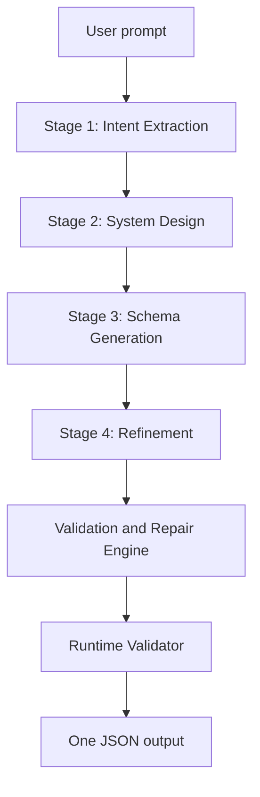

# SchemaForge — AI Schema Generation Platform

SchemaForge turns a plain-English app description into validated UI, API, DB and Auth schemas using a 4-stage LLM pipeline with automatic validation and repair. Built with FastAPI, Groq, Pydantic v2 and Render.

**Links:** [Live app](https://schemaforge-ai.vercel.app) · [Frontend repo](https://github.com/Lithinpavansai/AI_Builder_frontend) · [Postman collection](SchemaForge-Postman-Collection.json)

## Architecture Overview



## Key Components

**Stage 1, Intent Extraction:** parses the raw prompt into entities, roles, features and assumptions.

**Stage 2, System Design:** converts the intent into an architecture: pages, API groups, DB tables, auth flow and business rules.

**Stage 3, Schema Generation:** 5 focused Groq calls produce the UI, API, DB, Auth and Business Logic schemas. With the other stages, one request makes 8 LLM calls in total.

**Stage 4, Refinement:** finds and fixes cross-layer inconsistencies, such as:
- roles used in the UI or API but not defined in Auth
- DB relations pointing to tables that don't exist
- business rule routes with no matching API endpoint

**Validation and Repair Engine:** Pydantic v2 models enforce the schema contracts. A validation failure triggers auto-repair, up to 3 attempts per stage, then the pipeline degrades gracefully.

**Runtime Validator (0-100 score):** proves the output is executable with 6 checks: route completeness, auth coverage, DB coverage, role consistency, foreign key validity and business rule route validity.

## Live API

Base URL: `https://app-compiler-api.onrender.com`

| Endpoint | Method | Description |
|---|---|---|
| `/` | GET | Health check |
| `/api/generate/info` | GET | Pipeline stages and settings |
| `/api/generate` | POST | Full pipeline (sync) |
| `/api/generate/async` | POST | Full pipeline (returns a `job_id`) |
| `/api/status/{job_id}` | GET | Poll job progress |
| `/api/result/{job_id}` | GET | Fetch the completed result |
| `/api/runtime-validate` | POST | Runtime executability check |
| `/api/eval/dataset` | GET | View the test dataset |
| `/api/eval/run-single/{id}` | POST | Run a single eval prompt |
| `/docs` | GET | Swagger UI |

## Try It in 2 Minutes (Postman)

Import `SchemaForge-Postman-Collection.json`. The `base_url` variable is already set. The collection demonstrates:

| Request | Expected result | What it shows |
|---|---|---|
| Pipeline Info | 200 OK | The service is up and responding fast |
| Status - bad job id | 404 | An unknown job ID returns a clear error |
| Generate - invalid payload | 422 | A body missing the required `prompt` field is rejected before any LLM call |
| Auth - 401 then 200 | 401, then 200 | A 401 vs authenticated call (uses Postman's public test API) |

## Evaluation

23 test prompts: 20 run locally (10 normal and 10 edge cases) and 3 run on the live deployment.

- Normal: CRM, e-commerce, LMS, healthcare, HR, social media
- Edge cases: vague, single word, conflicting, incomplete, gibberish, non-English
- Live deployment: storefront catalog, prompt injection resistance, zero-user login handling

| Metric | Result |
|---|---|
| Completion | 100% |
| Average runtime validator score | 84 / 100 |

A manual audit of 3 outputs caught a real cross-layer bug: an Admin-only rule conflicted with a config that allowed the Customer role.

Run the evaluation:

```bash
python -m app.evaluation.runner
```

Run a single prompt:

```
POST /api/eval/run-single/N01
```

## Tech Stack

| Layer | Technology |
|---|---|
| Framework | FastAPI |
| LLM provider | Groq (`openai/gpt-oss-120b`) |
| Validation | Pydantic v2 |
| Async jobs | Python asyncio |
| Deployment | Render |

> **Model lifecycle notice:** Groq periodically deprecates and renames models. The active model ID is set by the `GROQ_MODEL` environment variable. All benchmark scores are tied to the model version named above.

## Getting Started

```bash
git clone https://github.com/Lithinpavansai/AI_Builder_Backend.git
cd AI_Builder_Backend
python -m venv venv
venv\Scripts\activate          # On macOS/Linux: source venv/bin/activate
pip install -r requirements.txt
cp .env.example .env           # On Windows: copy .env.example .env
# Set GROQ_API_KEY in .env (GROQ_MODEL defaults to openai/gpt-oss-120b)
python -m uvicorn app.main:app --reload
```

Swagger docs: http://localhost:8000/docs

## Known Limitations

- **"Async" endpoint blocks:** in my testing, `POST /api/generate/async` took about 9 seconds before returning, so it doesn't behave like a fully non-blocking job start.
- **No authentication:** the public endpoints respond without credentials.
- **Scores depend on the model:** evaluation results apply to the model version named above and may change if it is swapped.
